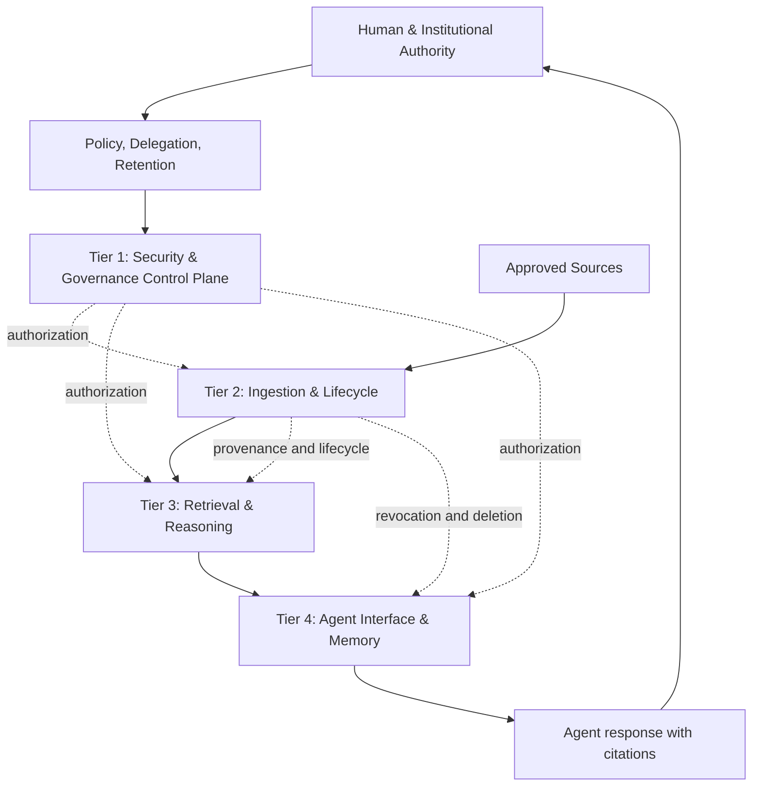

# Architecture and Data Flows

## Logical architecture

Tier 1 overlays every component. The diagram is logical: deployments may split services, combine tiers, or use managed infrastructure, but must preserve the control boundaries.

## Three flows

### 1. Knowledge flow

1. A source is registered and approved by an authorized owner.
2. A connector authenticates independently to the source.
3. The ingestion boundary establishes tenant and source identity from trusted configuration.
4. Content is parsed, normalized, classified, deduplicated, and versioned.
5. Quality and freshness checks determine whether the source is eligible for indexing.
6. Chunks and derived representations are written with tenant, ACL, source version, and provenance metadata.
7. Indexing acknowledgements are recorded for reconciliation.

### 2. Query flow

1. An authenticated user or service initiates a request.
2. A trusted gateway verifies identity and obtains an authorization decision.
3. The gateway creates a short-lived SecurityContext.
4. The retrieval service validates context and constrains all candidate sources by tenant and effective permissions before scoring or graph expansion.
5. Hybrid retrieval, fusion, and reranking operate only over authorized candidates.
6. The context assembler re-checks authorization and attaches citations and source versions.
7. The agent receives delimited, untrusted reference passages with provenance metadata.
8. The response is logged using safe metadata, not raw sensitive content.

### 3. Governance and lifecycle flow

1. A policy, permission, source, or retention event is received.
2. A revocation/tombstone state is committed to the authoritative control plane.
3. Reads are denied immediately for affected artifacts.
4. Events fan out to lexical/vector indexes, graph stores, caches, summaries, and memory.
5. Consumers acknowledge processing; retries are idempotent.
6. Reconciliation detects missed or stale projections.
7. Audit evidence records the event, decision, affected artifact counts, and completion status.

## Trust boundaries

- Identity provider to application gateway.
- Gateway/policy decision point to knowledge services.
- Connector runtime to external source systems.
- Knowledge stores to retrieval services.
- Retrieval/context assembler to agent model.
- Agent runtime to tools and consequential actions.
- Persistent memory to user, tenant, and retention controls.

Every boundary must define authentication, authorization, data classification, input validation, logging, and failure behavior.

## Control-plane and data-plane separation

The control plane owns identity assertions, policy evaluation, tenant mapping, revocation state, and audit decisions. The data plane processes documents, chunks, embeddings, graph facts, and query results. Data-plane services must not invent or broaden permissions. Policy outages must fail closed for protected operations unless a formally approved, narrowly scoped continuity policy explicitly states otherwise.

## Failure handling

- Unknown tenant or subject: deny.
- Expired context: deny and require re-authentication.
- Policy service unavailable: deny protected access.
- Revocation event not yet propagated: deny using authoritative tombstone/revocation state.
- Vector or graph provider unavailable: return a safe degraded result only if policy permits; never bypass authorization.
- Provenance missing or invalid: quarantine or exclude the artifact from evidence-bearing answers.
