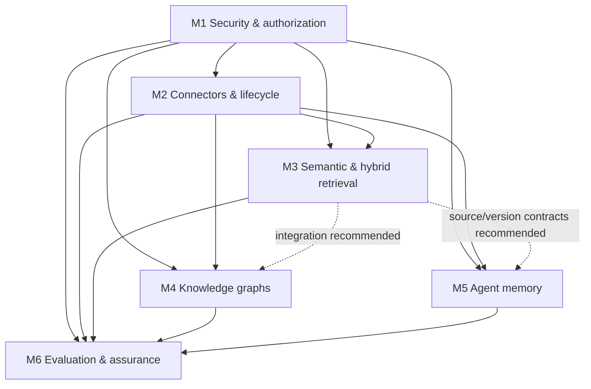

# BGLA Agent Knowledge Infrastructure — Implementation Roadmap

## Delivery model

This roadmap is implemented through GitHub issues #8–#13 under parent feature issue #6. Each issue is a milestone work package with its own scope and acceptance criteria. GitHub Milestone objects are not currently configured for this repository; the issue sequence is the source of delivery tracking.

## Dependency graph

M1 is the mandatory security prerequisite for all protected production capabilities. M2 establishes source identity and lifecycle contracts consumed by retrieval, graphs, and memory. M6 is an end-to-end assurance milestone and does not replace security gates in earlier milestones.

## Milestone gates

### M1 — Tier 1 security and authorization
Issue: [#8](https://github.com/DivineVirtuousChief/Portfolio-/issues/8)

**Deliver:** trusted identity boundary, policy decision integration, tenant-aware resource authorization, pre-retrieval enforcement, audit correlation, fail-closed behavior.

**Exit gate:** synthetic tests prove zero cross-tenant and unauthorized retrieval; authorization precedes candidate scoring, graph traversal, reranking, and context assembly; missing/expired context and policy failures deny; revocation blocks stale projections.

### M2 — Tier 2 ingestion and lifecycle
Issue: [#9](https://github.com/DivineVirtuousChief/Portfolio-/issues/9)

**Deliver:** approved connector contract, parser/normalizer, source registry, versioning, freshness/quality checks, event-driven lifecycle and deny-first cascade invalidation.

**Exit gate:** idempotent ingestion; source lineage on all derived artifacts; synthetic tests for update, expiry, revocation, deletion, duplicate events, delayed events, and reconciliation.

### M3 — Tier 3 semantic and hybrid retrieval
Issue: [#10](https://github.com/DivineVirtuousChief/Portfolio-/issues/10)

**Deliver:** embedding provider, tenant-aware vector store, lexical/semantic candidate fusion, reranking, citation and source-version preservation.

**Exit gate:** tests prove authorized candidate generation before scoring, correct exact and semantic retrieval, deterministic tie handling, provider failure safety, and citation traceability. Benchmark against the lexical baseline.

### M4 — Knowledge graph reasoning
Issue: [#11](https://github.com/DivineVirtuousChief/Portfolio-/issues/11)

**Deliver:** provider-neutral graph schema and adapters; source-backed entities/edges; bounded multi-hop traversal.

**Exit gate:** per-node and per-edge authorization tests; no restricted path metadata leakage; traversal budgets; lifecycle revocation and deletion tests.

### M5 — Agent memory governance
Issue: [#12](https://github.com/DivineVirtuousChief/Portfolio-/issues/12)

**Deliver:** distinct session and persistent memory stores; owner, tenant, purpose, provenance, epistemic labels, retention, expiry, deletion, and source dependency handling.

**Exit gate:** tests for tenant/owner isolation, purpose limitation, expiry, source revocation, deletion propagation, and correct distinction between source-backed, derived, user-provided, and inferred memories.

### M6 — Independent quality and security evaluation
Issue: [#13](https://github.com/DivineVirtuousChief/Portfolio-/issues/13)

**Deliver:** versioned synthetic benchmark, retrieval and citation metrics, freshness and revocation measurements, prompt-injection suite, and auditable reports.

**Exit gate:** reproducible evaluation runs, documented thresholds, no authorization regression, measured end-to-end lifecycle behavior, and explicit separation of implemented controls from independently verified outcomes.

## Cross-milestone Definition of Done

- Code and interfaces are typed, documented, and provider-neutral where appropriate.
- Security checks execute at the correct trust boundary; no client/model-supplied claims grant access.
- Unit, integration, negative, and failure-mode tests are included.
- Tenant isolation and authorization-leakage tests remain blocking CI checks after M1.
- Synthetic data is used unless data has been formally approved and sanitized.
- Audit and telemetry avoid secrets, PHI, protected content, and sensitive prompt bodies.
- Documentation and threat model are updated with each new adapter or trust boundary.
- Operational failure modes, retries, reconciliation, and recovery are documented.
- PR evidence identifies what is implemented, tested, and still deferred.

## Release posture

A milestone's issue completion is not equivalent to production certification. Production release requires security review, identity-provider integration, policy enforcement, operational monitoring, incident response, backup/recovery testing, data retention approval, and independent validation.
